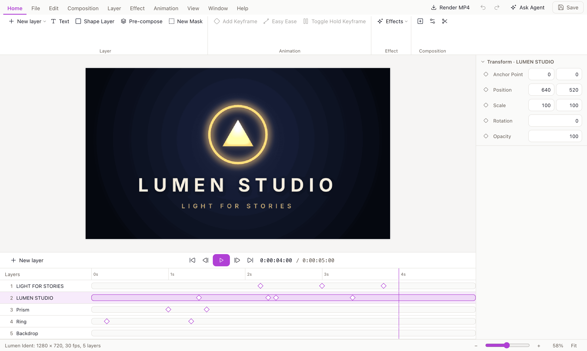
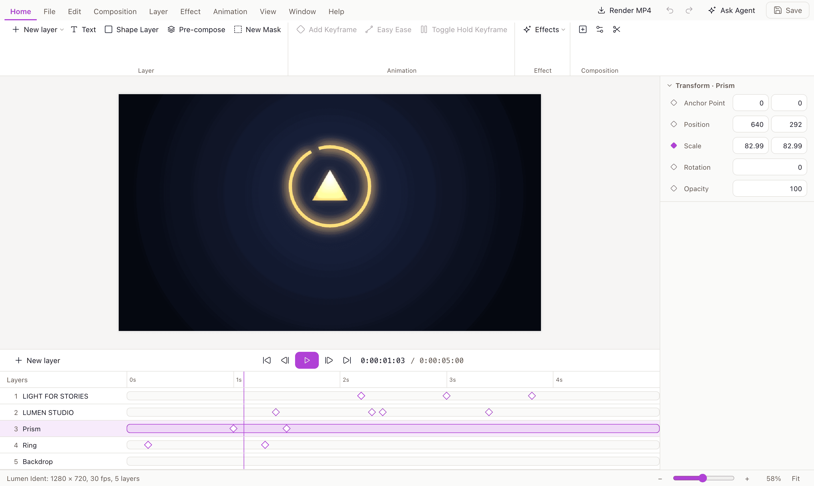
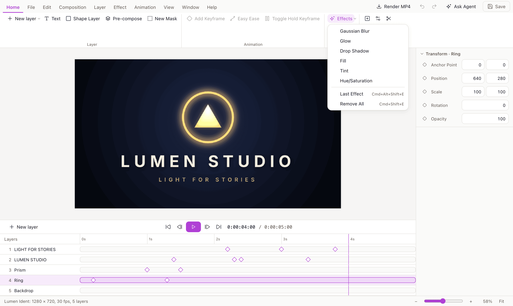
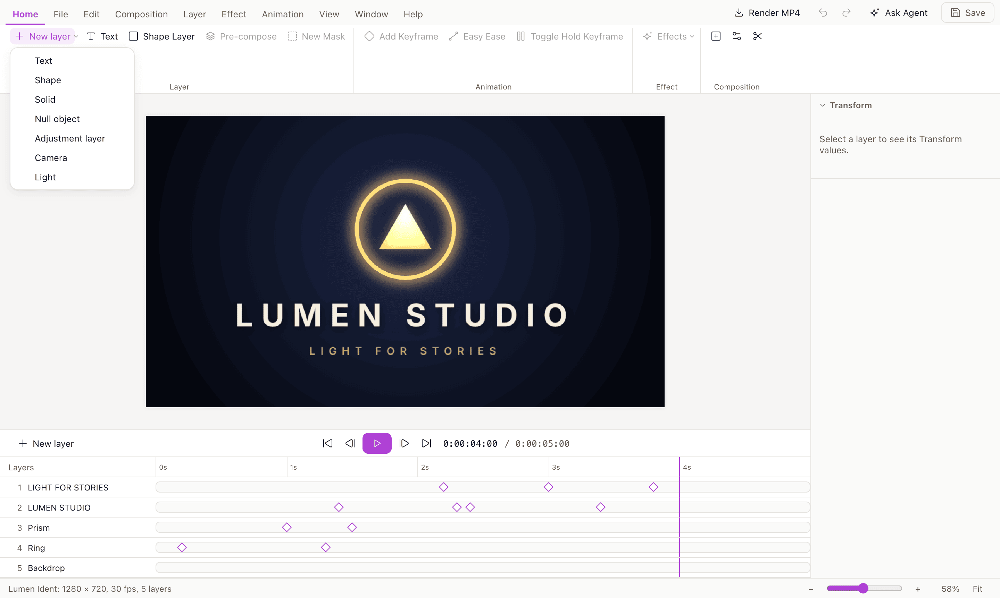
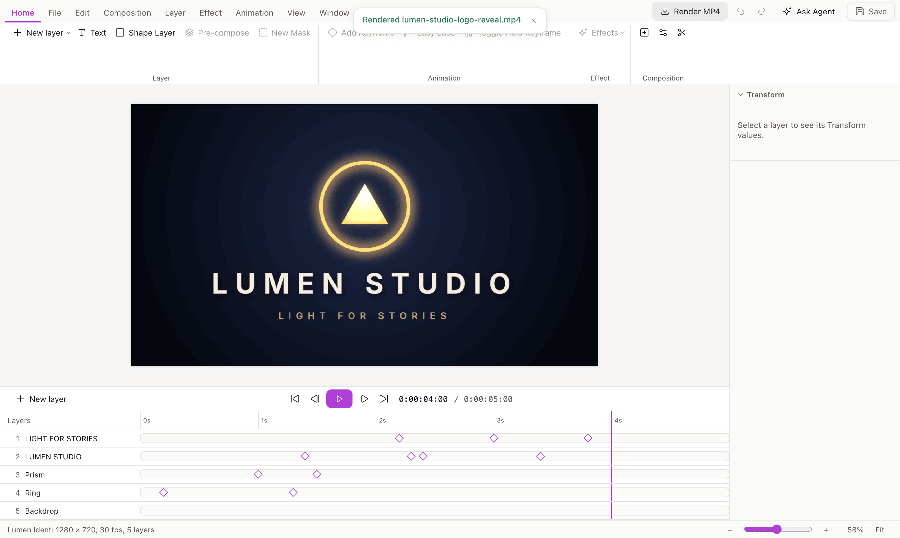
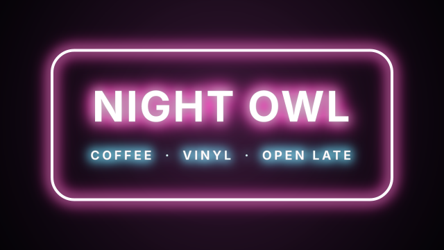
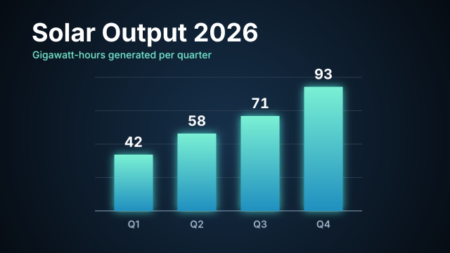
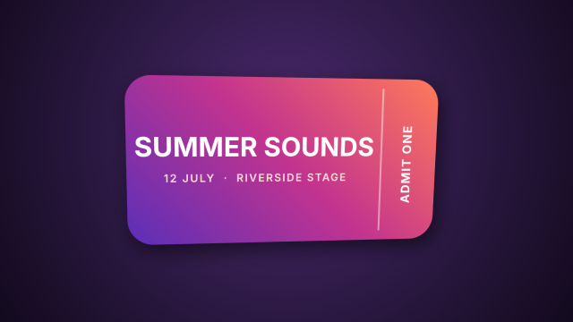

<div align="center">

# Kition Motion

**Kition Motion: a motion graphics editor with keyframes and effects, for people and AI agents**

Keyframes · Text, shape and solid layers · Effects · Masks · MP4 rendering · Tools for agents

[](LICENSE)
[](https://www.npmjs.com/package/@kition/embed)
[](https://github.com/kitharness/khp)
[](bindings/wasm)

[Use it in Kition](https://kition.ai) · [Embed it](#embed-it-in-your-app) · [Give it to your agent](#give-it-to-your-agent) · [Showcase](https://github.com/KitionAI/kition-showcase/tree/main/motion) · [Developer docs](https://developer.kition.ai) · [KHP](https://github.com/kitharness/khp)

</div>

A title, a logo sting or a lower third usually lives in one desktop program, on the one machine
that has the project. Reviews go back and forth as rendered videos, and every change means
opening that project again. An AI assistant can describe the animation you want, but it cannot
open the project and set the keyframes.

Motion puts a motion graphics editor in a browser tab, on a `.kmotion` project. You stack layers
on a timeline, set keyframes, add effects and render an MP4. The same engine runs headless for an
AI agent: it reads the composition, animates it with the editor's own commands, previews frames
and runs the same check. An agent's write names the revision it read, and a write that rests on
something you have since changed is refused instead of written over your work.



## What it does

### Why Motion

- **Animate with keyframes.** Change a value at the current time and Motion sets a keyframe
  there. Ease the keys, or drive a property with an expression.
- **The layers motion design needs.** Text, shape, solid and null layers. Rename, parent, blend
  and trim them; text keeps Chinese, Japanese, Korean and emoji as you typed them.
- **Effects on any layer.** Apply an effect, set its parameters and reorder the stack. Draw a mask
  from its points, close it and feather it.
- **An MP4 in one click.** Render MP4 writes the composition as an `.mp4` next to the project.
- **Your agent animates the same project.** An AI agent reads the layers and their keyframes,
  animates them, previews a frame or a contact sheet, and fixes what the check reports. It can
  work in a draft that you review before anything changes.
- **It runs in your web page.** The editor embeds in any page and reads and writes through your
  storage. The engine is Rust, compiled to WebAssembly, and runs in a Web Worker.

### See it

<table>
<tr>
<td width="50%"><br /><b>Keyframes</b>: the prism pops in on a keyframed Scale; the timeline shows every layer's keys.</td>
<td width="50%"><br /><b>Effects</b>: apply an effect to the selected layer; the ring's gold heat is the Glow effect.</td>
</tr>
<tr>
<td width="50%"><br /><b>Layers</b>: add a text, shape, solid or null layer from the ribbon or the timeline.</td>
<td width="50%"><br /><b>Render MP4</b>: one click, and the movie is written next to the project.</td>
</tr>
</table>

### Made with Motion

<table>
<tr>
<td width="25%"><a href="https://github.com/KitionAI/kition-showcase/tree/main/motion/ringed-planet-3d-title"></a></td>
<td width="25%"><a href="https://github.com/KitionAI/kition-showcase/tree/main/motion/neon-sign-flicker"></a></td>
<td width="25%"><a href="https://github.com/KitionAI/kition-showcase/tree/main/motion/solar-output-bar-chart"></a></td>
<td width="25%"><a href="https://github.com/KitionAI/kition-showcase/tree/main/motion/festival-ticket-card-flip"></a></td>
</tr>
</table>

Every sample is built with Motion's own commands. [See all of them](https://github.com/KitionAI/kition-showcase/tree/main/motion).

### Formats

| Opens | Creates | Exports |
| --- | --- | --- |
| `.kmotion` | `.kmotion` | `.mp4` |

## Quick start

### Use it in Kition

Open or create a `.kmotion` file in Kition and it opens in this editor. Kition's agent works on the
same project, with the same commands. [Download Kition](https://github.com/KitionAI/kition/releases/latest).

### Embed it in your app

Motion's editor is a static package you host yourself, mounted into your page with
[`@kition/embed`](https://www.npmjs.com/package/@kition/embed). Download
`kition-motion-<version>.tgz` from the [latest release](https://github.com/KitionAI/kition-motion/releases/latest)
and serve its `motion-ui/` folder on its own origin, with the headers in the
[embed reference](https://github.com/KitionAI/kition-sdk/blob/main/docs/platform/reference/embed.md).
Then:

```ts
import { KitionEmbed } from '@kition/embed'

const editor = await KitionEmbed.mount(document.getElementById('motion')!, {
  kit: { id: 'kit.motion', url: 'https://kits.example.com/motion-ui/' }, // the package you host
  file: { id: 'ident-2026', name: 'Ident.kmotion' },
  storage: {
    read: async (id) => api.read(id),                                     // { bytes, version }
    write: async (id, bytes, { expectedVersion }) => api.write(id, bytes, expectedVersion), // refuse a stale version
    create: async (name, bytes) => api.create(name, bytes),              // a rendered MP4 becomes a new file
  },
})
```

Every save carries the version it read, so an edit made elsewhere is never written over. The
[embed guide](https://github.com/KitionAI/kition-sdk/blob/main/docs/sdk/embed.md) adds people and
permissions, co-editing, and an agent working in the open editor.

### Give it to your agent

The engine also runs headless as the `kition-motion` program, and the SDK's `kition-kits-mcp` turns
it into MCP tools (`motion_inspect`, `motion_run`, `motion_check`, ...) on a folder of projects, for
any MCP client:

```sh
cargo build --release -p kition-motion
cargo install --git https://github.com/KitionAI/kition-sdk kition-kits --bin kition-kits-mcp
kition-kits-mcp --workspace <folder of projects> --kit target/release/kition-motion
```

A real session on a copy of the logo reveal above, trimmed:

```text
> motion_inspect {"path":"ident.kmotion"}
Opened `ident.kmotion`: 1280 × 720
{"details":{"comp":{"duration":5.0,"frameRate":30.0,"height":720,"id":1,"name":"Lumen Ident","width":1280},"design":[],
  "info":{…,"layers":[…,{"animated":[{"name":"Scale","path":"transform/scale","times":[1.0,1.5]}],…,"id":131,…,"name":"Prism",…,"type":"Shape"},
  {"animated":[{"name":"End","path":"contents/trim/end","times":[0.2,1.3]},…],…,"id":35,…,"name":"Ring",…},…]},…},"revision":"hym0",…}

> motion_run {"path":"ident.kmotion","basis":"hym0","steps":[
    {"command":"prop.addKey","params":{"layer":131,"path":"transform/rotation","time":1,"value":-90}},
    {"command":"prop.addKey","params":{"layer":131,"path":"transform/rotation","time":1.5,"value":0}},
    {"command":"keys.select","params":{"keys":[{"layer":131,"prop":"transform/rotation","time":1},
                                                {"layer":131,"prop":"transform/rotation","time":1.5}]}},
    {"command":"keys.easyEase","params":{}}]}
Ran 4 commands on `ident.kmotion` (saved): 1280 × 720 Changes: objects 1 changed.
{"changes":{"changed":[{"edits":[{"after":{"data":{…,"in_ease":[{"influence":0.3333333333333333,"speed":0}],"in_interp":"Bezier",…},
  "time":"254016000000","value":{"t":"Scalar","v":-90}},"before":null,…,"named":"transform/rotation.keys.0"},
  {"after":{…,"time":"381024000000","value":{"t":"Scalar","v":0}},"before":null,…,"named":"transform/rotation.keys.1"}],"id":131,"type":"Layer"}],…},
  "completed":[{"command":"prop.addKey","result":1},{"command":"prop.addKey","result":2},
    {"changed":false,"command":"keys.select","result":2},{"command":"keys.easyEase","result":2}],
  "diagnostics":{"new":[],"resolved":[]},"revision":"hym1","saved":true}

> motion_check {"path":"ident.kmotion"}
Checked `ident.kmotion`: the kit found nothing wrong.
{"diagnostics":[]}

> motion_export {"path":"ident.kmotion","to":"ident.mp4"}
Exported `ident.kmotion` as MP4 to `ident.mp4` (706186 bytes).
```

The agent read the composition and its layers with their keyframes, then made the prism turn as it
pops in: two Rotation keyframes on the Prism layer, from −90° at 1 s to 0° at 1.5 s, eased on both
sides. The check found nothing wrong, and the export rendered the five seconds to an MP4 beside the
project. The agent's guide is [agent/guide.md](agent/guide.md).

## Maturity

Version 0.1.0 · KHP 1.0, conformance level `basic`.

| Works today | Partly there | Not yet |
| --- | --- | --- |
| Compositions: size, frame rate, duration, background and markers | Shape layers, paths and text animators | Settings that outlast the open project |
| Text, shape, solid and null layers; parenting, blending and trimming | Cameras, lights and 3D | Auto-save and crash recovery |
| Keyframes, Easy Ease and expressions | Motion tracking and stabilization | Loading effect plug-ins and installing scripts in the editor |
| Effects with their parameters; masks with feathering | The render queue and outputs other than MP4 | Relinking missing footage |
| Rendering to MP4; an agent that reads, animates and checks a project | The menus: some entries do nothing in the editor yet | Opening `.aep` projects |

Known gaps: [docs/gaps.md](docs/gaps.md). What's next: [docs/roadmap.md](docs/roadmap.md).

## Build and contribute

Build and test instructions are in [docs/development.md](docs/development.md). Read
[CONTRIBUTING.md](.github/CONTRIBUTING.md) before opening a pull request, and ask questions in
[Discussions](https://github.com/KitionAI/kition/discussions) or on [Discord](https://discord.gg/bFSjRDjVY).

## License

Apache-2.0 ([LICENSE](LICENSE)). Third-party licenses and notices are listed in [NOTICE](NOTICE)
and [docs/attribution.md](docs/attribution.md).

Portions of this kit are derived from a project dual-licensed under MIT or Apache-2.0, used here
under the MIT License and credited in [NOTICE](NOTICE).
